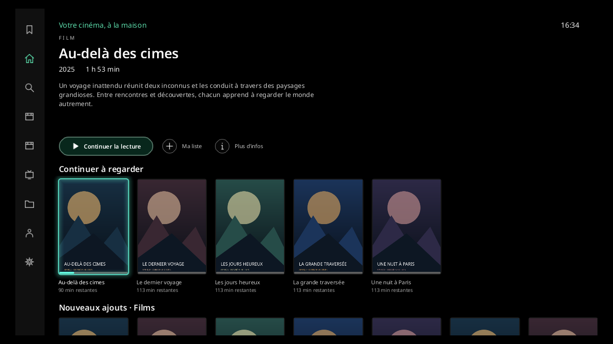

# Le Pavillon de Jade pour Plex

Client indépendant, gratuit et à code source ouvert pour regarder les films et séries de son Plex Media Server sur **Freebox Player Devialet**, à la télécommande.

**Version 0.5.2 en développement.** Le code est partageable ; l’application n’est pas encore publiée ni validée sur le FreeStore. La parité complète avec Plex officiel n’est pas acquise. Voir l’[audit comparatif et les preuves](docs/AUDIT.md), les [limites de lecture](docs/PLAYBACK.md) et les [conditions de confidentialité](PRIVACY.md).

Application non officielle, sans affiliation à Plex, Free ou Devialet. Aucun contenu vidéo ni accès à un serveur n’est fourni.



## Ce qui est disponible

- Interface française noire avec accents jade, focus télécommande, menus déroulants et zone d’affichage réglable de 90 à 100 %.
- Une seule sélection lumineuse ; barre latérale rétractable sur l’accueil et les bibliothèques. Six critères de tri, chacun dans les deux sens.
- Association par code sur `plex.tv/link`, option **Rester connecté**, choix des profils Plex Home avec PIN et découverte des serveurs partagés.
- Bibliothèques de films et séries triées, épinglage par profil et serveur, accueil « Continuer à regarder » puis nouveaux ajouts des bibliothèques épinglées.
- Watchlist Plex, recherche globale par titre, filtres de bibliothèque, collections, listes de lecture existantes, dossiers, saisons/épisodes, informations techniques, distribution et filmographie dans la bibliothèque courante.
- Lecture directe prioritaire, reprise et secours par conversion serveur jusqu’à 1080p. Pistes audio, sous-titres incrustés, versions, qualité, chapitres et heure de fin estimée.
- Saut des intros et génériques à partir des repères Plex, thèmes musicaux, bandes-annonces et bonus fournis par le serveur.
- Épisode suivant avec compte à rebours de 15 secondes, annulable ; arrêt de l’automatisme après deux heures sans interaction pour les épisodes longs. Bande-annonce avant un film en option.
- Fiches avec actions compactes, icône de bobine pour les bandes-annonces, rangées de distribution et de bonus, retour à l’interprète sélectionné après sa filmographie.
- Résultats explicitement adultes masqués par défaut dans la recherche. Les classifications d’âge classiques, notamment 18+, restent visibles. Dans Mes bibliothèques, Menu ouvre les classifications « Non précisée », « Public averti » et « 18+ · Contenus explicites » ; seule la dernière entre dans ce filtre.

Au premier accès à un profil/serveur, choisissez les bibliothèques à épingler. **Aucun nom de dossier n’est exclu par le code.** Ne pas épingler une bibliothèque la retire du menu et de l’accueil ; cela ne retire pas les autorisations accordées par Plex. Le filtre adulte dépend des métadonnées et des bibliothèques signalées : il ne peut pas reconnaître automatiquement une vidéo non classée.

## Essayer la version développeur

Prérequis : Windows, Python 3.10 ou supérieur, un Player Devialet allumé avec le mode développeur actif, sur le même réseau local que le PC, et un compte ayant accès à un Plex Media Server. Le serveur peut être hébergé ailleurs ; les essais matériels documentés ont été faits avec Windows et une Delta S.

1. Télécharger ou cloner ce dépôt.
2. Double-cliquer sur **Lancer-Cinema.cmd** et garder la fenêtre ouverte.
3. Sur la TV, associer le compte Plex, choisir le profil puis les bibliothèques à épingler.

Le lanceur détecte le Player et ne sert que les ressources publiques de `app/`. Il ne modifie ni routeur, ni pare-feu, ni autre application. Le mode développeur **n’installe pas** l’application. L’installation autonome et les favoris passent par une future distribution FreeStore ; voir [distribution/INSTALLATION-FREESTORE.txt](distribution/INSTALLATION-FREESTORE.txt).

Télécommande : flèches pour naviguer, OK pour choisir, Retour pour revenir. Menu ouvre les paramètres. Pendant une vidéo : OK pause/reprise, gauche/droite ±10 secondes, **Bas masque les commandes, Haut les réaffiche**, Menu ouvre les options audio/sous-titres. Masquer les commandes ne change pas l’état de lecture ou de pause. La touche Retour suffit à quitter le sélecteur de profils.

## Développer et vérifier

QML QtQuick 2.4, QtMultimedia 5.5 et `fbx.application` côté Player. JavaScript compatible avec son moteur embarqué. Aucun serveur applicatif supplémentaire n’est nécessaire en utilisation normale.

```powershell
node --test tests/auth.test.cjs tests/request.test.cjs tests/playback.test.cjs tests/transcode.test.cjs
python -X utf8 -m unittest discover -s tests -v
python -m venv .venv
.venv/Scripts/python -m pip install -r requirements-dev.txt
.venv/Scripts/python -X utf8 tools/preview.py --store
.venv/Scripts/python -X utf8 tools/preview-playback.py
.venv/Scripts/python -X utf8 tools/store_assets.py
python -X utf8 tools/package_freestore.py --identifier fr.example.plexdevialet
python -X utf8 tools/check_public.py
```

Les prévisualisations utilisent les composants réels avec des données fictives ; elles ne remplacent pas un essai sur le Player. `fr.example.plexdevialet` est un exemple pour construire localement : le dépôt FreeFactory exige le préfixe réel du compte développeur. L’archive reproductible gzip/USTAR, son empreinte et son rapport sont créés dans `dist/` ; aucun envoi n’est réalisé par le constructeur.

Les outils `check-catalog.py`, `check-playback.py` et `preview-library.py` sont des contrôles matériels facultatifs réservés à un poste Windows hébergeant son propre PMS. Ils ne tournent jamais en CI. Ils peuvent lire son jeton en mémoire et créer des données privées dans `.local/` ; ne jamais partager ce dossier. Les prérequis et limites sont décrits dans [CONTRIBUTING.md](CONTRIBUTING.md).

`tools/check-ui.py` exerce les composants sur le vrai Player avec des données fictives, sans jeton ni accès à la médiathèque. `tools/ui_audit.py`, intégré à `preview.py`, vérifie notamment le focus visible unique, les états vides, les tris, les longues listes, les retours et les limites de pagination.

## Participer

Le code original est sous licence MIT. Les polices et marques conservent leurs droits propres : [LICENSE](LICENSE), [NOTICE.md](NOTICE.md), [provenance des ressources](app/assets/SOURCES.md). L’[architecture](docs/ARCHITECTURE.md) décrit les responsabilités des modules. Les contributions, corrections et reprises du projet sont bienvenues ; voir [CONTRIBUTING.md](CONTRIBUTING.md). Les signalements de sécurité suivent [SECURITY.md](SECURITY.md).

Le dépôt contient le code, les outils et tests reproductibles, ainsi que des captures fictives. Les identifiants, bibliothèques réelles, adresses réseau, paramètres de comptes et journaux privés ne font pas partie des sources.
